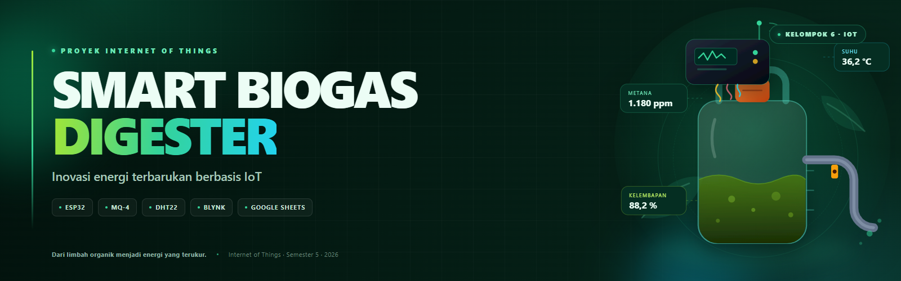
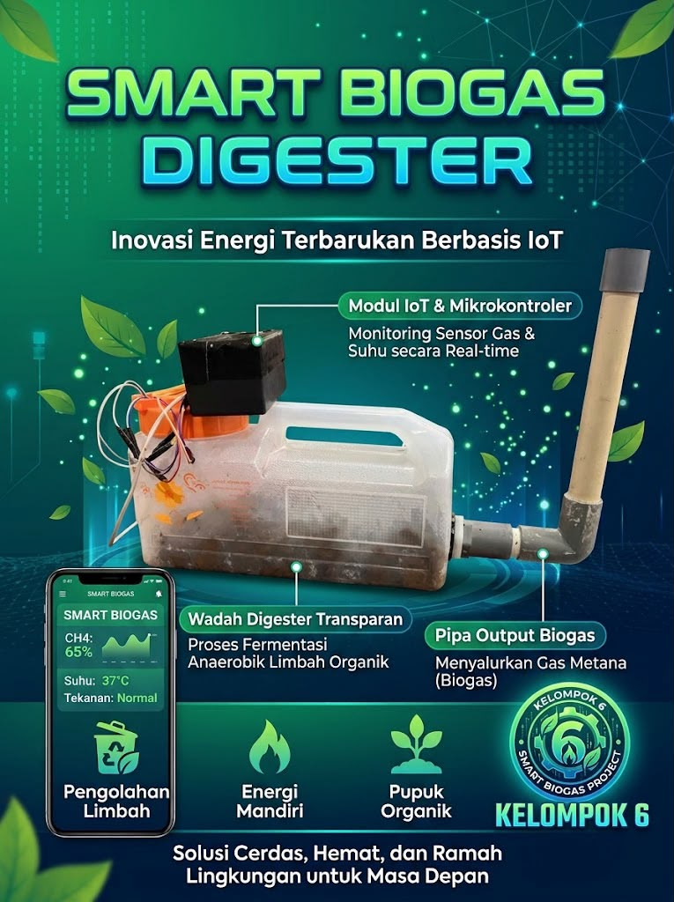
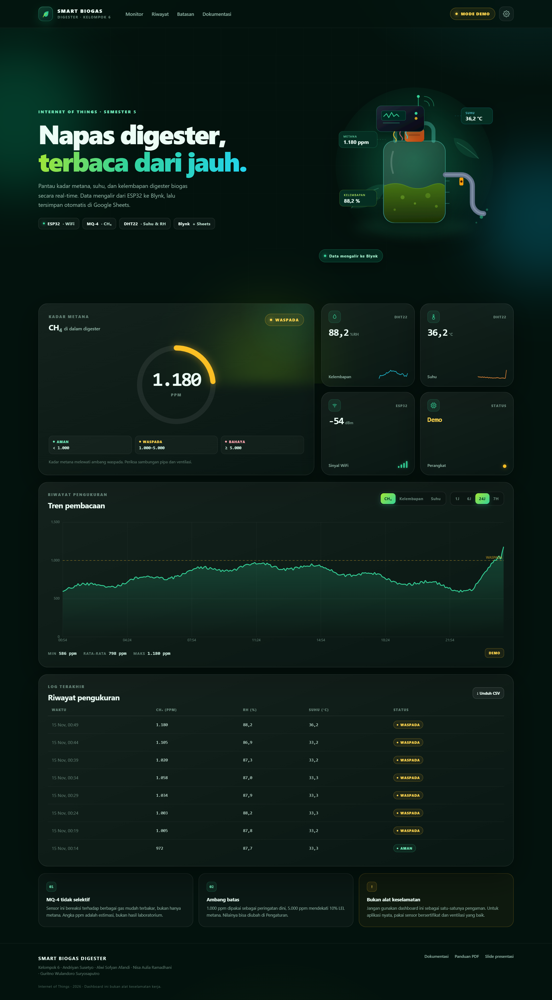
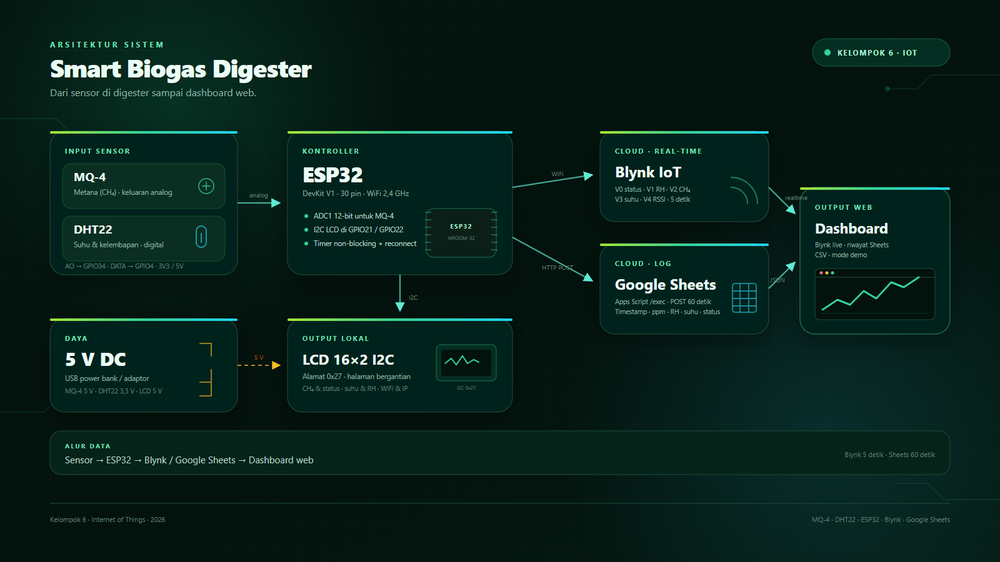
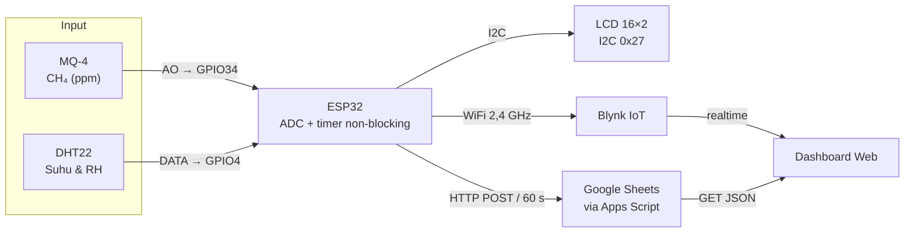
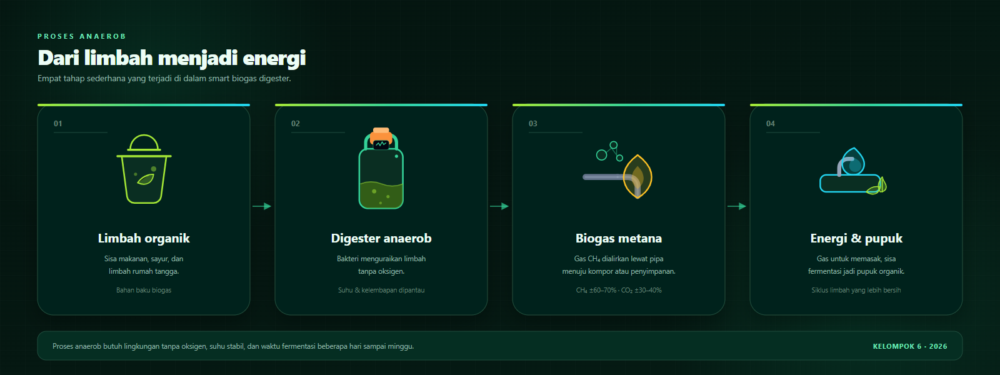
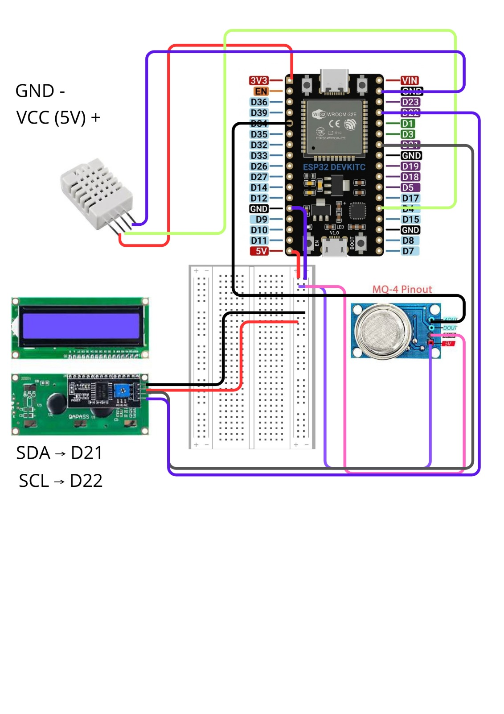

[](assets/banner.png)

[](https://www.espressif.com/)
[](https://www.arduino.cc/en/software)
[](https://blynk.io/)
[](https://sheets.google.com/)
[](index.html)
[]()
[](https://github.com/fannndi-2nd/smart-biogas-digester)

**Digester biogas sederhana yang membaca kadar metana, suhu, dan kelembapan — lalu mengirimnya ke Blynk dan Google Sheets secara otomatis.**

[Fitur](#fitur-utama) • [Arsitektur](#arsitektur-sistem) • [Komponen](#komponen) • [Wiring](#diagram-rangkaian) • [Dashboard](#dashboard-web) • [Cara Menjalankan](#cara-menjalankan) • [Dokumen](#dokumen-pendukung)

---

## Tentang Project

Sampah organik rumah tangga bisa berubah menjadi biogas melalui fermentasi anaerob. Namun, proses di dalam digester tidak terlihat: kadar gas, suhu, dan kelembapan berubah terus-menerus. **Smart Biogas Digester** menjawab masalah itu dengan lapisan IoT yang murah dan mudah dirakit.

Otak sistem ini adalah **ESP32**. Ia membaca **MQ-4** untuk estimasi gas metana (CH₄), **DHT22** untuk suhu dan kelembapan, lalu menampilkan data di **LCD 16×2 I2C**. Setiap 2 detik data dikirim ke **Blynk IoT**, dan setiap 60 detik dicatat ke **Google Sheets** melalui Apps Script. Sebuah **dashboard web** membaca data live dari Blynk dan riwayat dari Sheets, lengkap dengan grafik, status, dan unduhan CSV.

Project ini dibuat untuk mata kuliah **Internet of Things** dan dipamerkan sebagai prototipe tugas akhir semester.

| Poster pameran | Dashboard web |
|---|---|
|  |  |

> **Catatan jujur:** angka **CH₄ 65%** pada poster adalah gambaran kandungan metana di dalam biogas, bukan hasil pembacaan sensor. MQ-4 mengukur gas mudah terbakar di udara dalam satuan **ppm**. Penjelasan lengkap ada di [Batasan & Kejujuran Data](#batasan--kejujuran-data).

## Daftar Isi

- [Fitur Utama](#fitur-utama)
- [Arsitektur Sistem](#arsitektur-sistem)
- [Cara Kerja](#cara-kerja)
- [Komponen](#komponen)
- [Diagram Rangkaian](#diagram-rangkaian)
- [Pemetaan Pin](#pemetaan-pin)
- [Datastream Blynk](#datastream-blynk)
- [Struktur Google Sheets](#struktur-google-sheets)
- [Dashboard Web](#dashboard-web)
- [Struktur Repositori](#struktur-repositori)
- [Cara Menjalankan](#cara-menjalankan)
- [Parameter yang Dapat Disetel](#parameter-yang-dapat-disetel)
- [Kalibrasi MQ-4 dan DHT22](#kalibrasi-mq-4-dan-dht22)
- [Hasil Pengujian](#hasil-pengujian)
- [Batasan & Kejujuran Data](#batasan--kejujuran-data)
- [Troubleshooting](#troubleshooting)
- [Keamanan](#keamanan)
- [Pengembangan Selanjutnya](#pengembangan-selanjutnya)
- [Dokumen Pendukung](#dokumen-pendukung)
- [Tim](#tim)
- [Lisensi](#lisensi)

## Fitur Utama

| | Fitur | Penjelasan |
|---|---|---|
| 🌱 | **Monitoring CH₄** | MQ-4 membaca gas mudah terbakar; firmware menghitung estimasi ppm dari kurva datasheet |
| 🌡️ | **Suhu & kelembapan** | DHT22 membaca kondisi di sekitar digester, dengan offset kalibrasi |
| 📟 | **LCD 3 halaman** | CH₄ + status, suhu + kelembapan, WiFi + IP — bergantian tiap 3 detik |
| 📡 | **Blynk real-time** | Status, RH, CH₄, suhu, dan RSSI dikirim ke cloud tiap 2 detik |
| 🗄️ | **Log Google Sheets** | Apps Script mencatat timestamp, ppm, RH, suhu, status, RSSI, dan uptime |
| 🖥️ | **Dashboard web** | Grafik, kartu status, riwayat, unduh CSV, mode demo, dan pengaturan token |
| 🛡️ | **Ambang dua tingkat** | 1.000 ppm = WASPADA, 5.000 ppm = BAHAYA, dengan histeresis agar status tidak berkedip |
| 🔁 | **Tahan koneksi** | WiFi dan Blynk dicek ulang otomatis; sensor tetap membaca saat jaringan putus |
| 🔐 | **Secret terpisah** | Token Blynk, password WiFi, dan URL Apps Script tidak pernah masuk repo |

## Arsitektur Sistem

[](assets/diagram-blok.png)



| Jalur | Peran |
|---|---|
| **Sensor → ESP32** | MQ-4 (analog, setelah pembagi tegangan) dan DHT22 (digital) |
| **ESP32 → LCD** | Umpan balik lokal tanpa perlu internet |
| **ESP32 → Blynk** | Monitoring real-time dari aplikasi atau web Blynk |
| **ESP32 → Sheets** | Arsip jangka panjang untuk grafik dan CSV |
| **Blynk / Sheets → Dashboard** | Dashboard menggabungkan data live dan riwayat |

[](assets/ilustrasi-proses.png)

## Cara Kerja

### 1. Membaca kadar metana

MQ-4 mengeluarkan tegangan analog yang berubah terhadap konsentrasi gas. Karena modul diberi **5 V** dan ADC ESP32 hanya tahan **3,3 V**, output **AO** dilewatkan pembagi tegangan **R1 = 1 kΩ** (seri) dan **R2 = 2 kΩ** (ke GND). Hasilnya masuk ke **GPIO34** (ADC1).

```text
Vout      = ADC / 4095 × 3,3 V
Vsensor   = Vout × (R1 + R2) / R2
Rs        = (VCC − Vsensor) / Vsensor × RL
ratio     = Rs / R0
CH₄ (ppm) = a × ratio^b
```

Dengan `VCC = 5 V`, `RL = 1000 Ω`, `R0 = 1000 Ω`, `a = 1012,7`, dan `b = −2,786`. Nilai `R0` **wajib dikalibrasi** di udara bersih setelah sensor di-burn-in.

Firmware mengambil **16 sampel** lalu dirata-rata, menghitung ppm, dan menentukan status:

| Status | Syarat | Arti |
|---|---|---|
| `WARMUP` | 3 menit pertama setelah boot | Sensor sedang stabilisasi |
| `AMAN` | < 1.000 ppm | Di bawah ambang peringatan |
| `WASPADA` | ≥ 1.000 ppm | Early warning, periksa ventilasi |
| `BAHAYA` | ≥ 5.000 ppm | Mendekati 10% LEL metana |

### 2. Membaca suhu dan kelembapan

DHT22 membaca suhu dan kelembapan relatif. Firmware menambahkan offset `HUM_OFFSET = −7,0` (hasil pembandingan dengan higrometer) dan `TEMP_OFFSET = 0,0`. Nilai yang tidak valid (`NaN`) tidak menimpa pembacaan terakhir.

### 3. Menampilkan di LCD

LCD I2C 16×2 menampilkan tiga halaman bergantian:

```text
┌────────────────┐   ┌────────────────┐   ┌────────────────┐
│ CH4:  1180 ppm │   │ Hum :  88.2 %  │   │ WiFi:  -54 dBm │
│ Status:WASPADA │   │ Temp:  36.2 C  │   │ IP:192.168.1.7 │
└────────────────┘   └────────────────┘   └────────────────┘
```

### 4. Mengirim ke cloud

- **Blynk** menerima `V0`–`V4` setiap 2 detik.
- **Google Sheets** menerima satu baris setiap 60 detik melalui `HTTP POST` ke Web App Apps Script.
- Jika WiFi putus, pembacaan tetap berjalan dan LCD tetap hidup. Pengiriman dilewati sampai koneksi kembali.

## Komponen

| Komponen | Jumlah | Fungsi |
|---|---|---|
| ESP32 DevKit V1 (30 pin) | 1 | Mikrokontroler + WiFi 2,4 GHz |
| Modul sensor MQ-4 | 1 | Estimasi gas metana / gas mudah terbakar |
| DHT22 (AM2302) | 1 | Suhu dan kelembapan |
| LCD 16×2 + modul I2C (0x27) | 1 | Tampilan lokal |
| Resistor 1 kΩ | 1 | Seri pembagi tegangan MQ-4 |
| Resistor 2 kΩ | 1 | Ke GND pembagi tegangan |
| Breadboard mini + jumper | 1 set | Rangkaian prototipe |
| Power bank / adaptor 5 V | 1 | Catu ESP32, MQ-4, dan LCD |
| Jerigen 5 L transparan | 1 | Wadah digester |
| Tutup oranye + sealant | 1 | Penutup kedap |
| Pipa PVC + kran | 1 set | Saluran biogas |
| Limbah organik + air | — | Bahan fermentasi |

> **Penting:** MQ-4 dan LCD memakai 5 V. DHT22 memakai 3,3 V. Semua GND harus disatukan. Jangan memberi 5 V langsung ke pin GPIO ESP32.

## Diagram Rangkaian

<p align="center">
  
</p>

<p align="center"><em>Diagram wiring: ESP32, DHT22, LCD I2C, dan MQ-4. Breadboard dipakai sebagai jalur daya dan GND.</em></p>

## Pemetaan Pin

| Bagian | Pin ESP32 | Keterangan |
|---|---|---|
| MQ-4 AO | GPIO34 | ADC1, setelah pembagi 1 kΩ / 2 kΩ |
| MQ-4 VCC | 5 V | Modul MQ-4 |
| MQ-4 GND | GND | Ground bersama |
| DHT22 DATA | GPIO4 | Digital, pull-up 10 kΩ bila modul tidak punya |
| DHT22 VCC | 3V3 | Jangan 5 V |
| DHT22 GND | GND | Ground bersama |
| LCD SDA | GPIO21 | I2C |
| LCD SCL | GPIO22 | I2C |
| LCD VCC | 5 V | Modul I2C |
| LCD GND | GND | Ground bersama |
| Catu 5 V | VIN / 5V | Power bank atau adaptor |
| GND | GND | Semua komponen |

> Semua pembacaan analog memakai **ADC1** (GPIO32–39) agar tetap bekerja saat WiFi aktif.

## Datastream Blynk

Buat template **Smart Biogas Digester** di [Blynk Console](https://blynk.cloud), lalu tambahkan datastream berikut:

| Virtual pin | Nama | Tipe | Satuan | Rentang |
|---|---|---|---|---|
| `V0` | Status | String | — | `WARMUP`, `AMAN`, `WASPADA`, `BAHAYA` |
| `V1` | Kelembapan | Double | % | 0–100 |
| `V2` | CH₄ | Double | ppm | 0–10000 |
| `V3` | Suhu | Double | °C | 0–60 |
| `V4` | RSSI | Double | dBm | −120–0 |

Widget yang disarankan: **Label** untuk `V0`, **Gauge** untuk `V1`–`V3`, **Chart** untuk `V2`, dan **Value Display** untuk `V4`.

> Token Blynk hanya ditulis di `config.h` (tidak di-commit) dan di pengaturan dashboard (localStorage). Jangan pernah menaruhnya di README atau screenshot.

## Struktur Google Sheets

`apps-script/Code.gs` membuat sheet **Log** dengan kolom:

| Kolom | Isi |
|---|---|
| A | Timestamp (Asia/Jakarta) |
| B | Device (`biogas-01`) |
| C | CH₄ (ppm) |
| D | Kelembapan (%) |
| E | Suhu (°C) |
| F | Status |
| G | RSSI (dBm) |
| H | Uptime (detik) |

- `doPost` menerima JSON dari ESP32 dan menambah baris.
- `doGet` mengembalikan JSON riwayat untuk dashboard.
- Baris lama dipangkas otomatis setelah 20.000 baris.
- URL `/exec` bersifat sensitif; jangan dibagikan di repo publik.

## Dashboard Web


- **Live** dari Blynk (`getAll` + `isHardwareConnected`) setiap 5 detik.
- **Riwayat** dari Google Sheets setiap 60 detik, dengan fallback JSONP.
- **Grafik** CH₄ / kelembapan / suhu, rentang 1 jam–7 hari.
- **Tabel** 8 pembacaan terakhir + unduh CSV.
- **Mode demo** otomatis jika token belum diisi — aman untuk pameran tanpa internet.
- **Pengaturan** menyimpan token, URL Sheets, dan ambang di `localStorage`.

### Menjalankan dashboard

```bash
git clone https://github.com/fannndi-2nd/smart-biogas-digester.git
cd smart-biogas-digester
python -m http.server 8000
```

Buka `http://localhost:8000`, klik ikon ⚙️, lalu isi token Blynk. Untuk GitHub Pages: **Settings → Pages → Deploy from a branch → `main` / root**. Setelah aktif, dashboard bisa dibuka di `https://fannndi-2nd.github.io/smart-biogas-digester/`.

> Dashboard client-side tidak bisa menyembunyikan token dari devtools. Untuk demo publik, gunakan **mode demo** atau letakkan token di proxy serverless.

## Struktur Repositori

```text
smart-biogas-digester/
├── index.html                  # Dashboard web (GitHub Pages)
├── README.md
├── LICENSE
├── .gitignore
├── firmware/
│   └── smart_biogas_digester/
│       ├── smart_biogas_digester.ino
│       └── config.example.h    # placeholder, bukan rahasia
├── apps-script/
│   └── Code.gs                 # logger + API riwayat
├── docs/
│   ├── Panduan_Smart_Biogas_Digester.pdf
│   ├── Presentasi_Smart_Biogas_Digester.pptx
│   ├── Blog_Smart_Biogas_Digester.md
│   └── CHECKLIST.md
└── assets/
    ├── banner.png
    ├── poster.jpg
    ├── diagram-rangkaian.jpg
    ├── diagram-blok.svg
    ├── diagram-blok.png
    ├── ilustrasi-digester.svg
    ├── ilustrasi-digester.png
    ├── ilustrasi-proses.svg
    ├── ilustrasi-proses.png
    ├── dashboard.png
    ├── dashboard-ppt.png
    ├── settings-panel.png
    └── vendor/chart.umd.min.js
```

## Cara Menjalankan

### 1. Rakit perangkat keras

Ikuti [diagram rangkaian](#diagram-rangkaian). Urutan yang disarankan:

1. Sambungkan **GND** semua komponen.
2. Beri **5 V** ke ESP32 (VIN/5V), MQ-4, dan LCD.
3. Beri **3,3 V** ke DHT22.
4. Pasang pembagi **1 kΩ / 2 kΩ** di AO MQ-4 sebelum GPIO34.
5. Pasang LCD di SDA 21 / SCL 22.
6. Pastikan tidak ada kabel 5 V yang masuk ke GPIO.

### 2. Siapkan Blynk

1. Buat template dan datastream `V0`–`V4` seperti tabel di atas.
2. Salin **Template ID**, **Template Name**, dan **Auth Token**.
3. Tempel ke `config.h`.

### 3. Siapkan Google Sheets

1. Buat Spreadsheet baru, beri nama **Log Smart Biogas**.
2. **Extensions → Apps Script**, tempel isi `apps-script/Code.gs`.
3. Jalankan `setup()` sekali dan izinkan akses.
4. **Deploy → New deployment → Web app**:
   - Execute as: **Me**
   - Who has access: **Anyone**
5. Salin URL `/exec` ke `SHEETS_URL` di `config.h`.

### 4. Upload firmware

1. Pasang **Arduino IDE 2.x** dan board **esp32 by Espressif**.
2. Pasang library: **Blynk**, **DHT sensor library** (Adafruit), **Adafruit Unified Sensor**, **LiquidCrystal_I2C**.
3. Salin `config.example.h` menjadi `config.h` di folder sketch, lalu isi.
4. Pilih board **ESP32 Dev Module**, port yang benar, lalu **Upload**.
5. Jika gagal, tahan tombol **BOOT** saat proses upload.

> `config.h` sudah masuk `.gitignore`. Jangan pernah commit file itu.

### 5. Jalankan dashboard

Buka `index.html` lewat server lokal (lihat [Dashboard](#dashboard-web)), isi token Blynk, lalu simpan. Data live akan muncul otomatis.

## Parameter yang Dapat Disetel

Semua ada di bagian atas `smart_biogas_digester.ino`:

| Parameter | Nilai bawaan | Fungsi |
|---|---|---|
| `CH4_WARN_PPM` | 1000 | Ambang WASPADA (early warning) |
| `CH4_DANGER_PPM` | 5000 | Ambang BAHAYA (±10% LEL) |
| `CH4_HYST_PPM` | 100 | Histeresis agar status tidak berkedip |
| `HUM_OFFSET` | −7.0 | Koreksi kelembapan DHT22 |
| `TEMP_OFFSET` | 0.0 | Koreksi suhu DHT22 |
| `WARMUP_MS` | 180000 | Stabilisasi awal 3 menit |
| `SENSOR_INTERVAL_MS` | 2000 | Interval baca sensor & kirim Blynk |
| `LCD_INTERVAL_MS` | 3000 | Interval ganti halaman LCD |
| `SHEETS_INTERVAL_MS` | 60000 | Interval log ke Sheets |
| `R0` | 1000 | Resistansi sensor di udara bersih |
| `MQ_A` / `MQ_B` | 1012.7 / −2.786 | Konstanta kurva MQ-4 |
| `RL` | 1000 | Beban sensor |
| `R1` / `R2` | 1000 / 2000 | Pembagi tegangan |

## Kalibrasi MQ-4 dan DHT22

### Burn-in

MQ-4 perlu **burn-in 24–48 jam** pertama kali dipakai. Selama itu, pembacaan bisa tinggi dan tidak stabil. Lakukan di tempat berventilasi, jauh dari gas mudah terbakar.

### R0 di udara bersih

1. Biarkan sensor menyala di udara bersih minimal 24 jam.
2. Baca nilai ADC mentah dari Serial (tambahkan log sementara bila perlu).
3. Hitung `Rs` dengan rumus di atas.
4. Nilai `Rs` di udara bersih adalah `R0`; ganti konstanta `R0` di firmware.
5. Upload ulang dan bandingkan dengan pembacaan referensi.

### Offset DHT22

Bandingkan dengan higrometer/termometer terkalibrasi pada kondisi yang sama. Selisihnya menjadi `HUM_OFFSET` atau `TEMP_OFFSET`. Jangan mengoreksi lebih dari ±10% RH tanpa data pembanding.

### Batas akurasi

MQ-4 adalah sensor gas **murah dan tidak selektif**. Kurva datasheet memberi estimasi, bukan nilai laboratorium. Untuk aplikasi nyata, gunakan sensor CH₄ khusus (mis. NDIR) atau alat terkalibrasi.

## Hasil Pengujian

Isi tabel ini dengan data pengujianmu. Nilai `—` adalah placeholder.

| Pengujian | Metrik | Hasil | Catatan |
|---|---|---|---|
| Waktu warm-up | Menit sampai stabil | — | Amati Serial/LCD |
| Udara bersih | CH₄ (ppm) | — | Setelah burn-in |
| Dekat sumber gas | CH₄ (ppm) | — | Mis. dekat kompor/fermentasi |
| Kelembapan | Selisih vs higrometer (%) | — | 3 kali pengukuran |
| Suhu | Selisih vs termometer (°C) | — | 3 kali pengukuran |
| Latensi Blynk | Detik (target ±2 s) | — | Lihat timestamp |
| Interval Sheets | Detik (target 60 s) | — | Cek baris baru |
| LCD | Keterbacaan 3 halaman | — | Siang/malam |
| Uptime | Jam tanpa restart | — | Pantau Serial |
| Jangkauan WiFi | Meter / RSSI | — | Dalam ruangan |

> Jangan mengarang angka. Lebih baik menulis “belum diuji” daripada hasil yang tidak bisa dipertanggungjawabkan.

## Batasan & Kejujuran Data

- **MQ-4 tidak selektif.** Sensor ini juga bereaksi terhadap LPG, asap, alkohol, dan gas mudah terbakar lain. Angka ppm adalah **estimasi**, bukan kadar metana murni.
- **Bukan alat keselamatan.** Jangan jadikan dashboard satu-satunya pengaman. Gunakan ventilasi, sensor bersertifikat, dan prosedur keselamatan.
- **Tidak ada sensor tekanan.** Poster menampilkan “Tekanan: Normal” sebagai ilustrasi; alat ini tidak mengukur tekanan.
- **CH₄ 65% di poster** adalah kandungan metana di dalam biogas (ilustrasi), bukan pembacaan MQ-4. Dashboard menampilkan **ppm di udara**.
- **Ambang 1.000 ppm** adalah early warning, bukan batas ledakan. LEL metana sekitar **5% volume** atau **50.000 ppm**.
- **Tidak ada aktuator.** Sistem hanya memantau; belum ada kran otomatis, buzzer, atau pemantik.
- **Blynk free plan** punya batas perangkat dan rate API. Untuk produksi, pertimbangkan MQTT/InfluxDB/Grafana.

## Troubleshooting

| Gejala | Kemungkinan penyebab | Solusi |
|---|---|---|
| Upload gagal | Kabel USB bukan data / driver | Ganti kabel, pasang driver CP210x/CH340, tahan BOOT |
| LCD blank | Alamat I2C salah | Coba `0x27` atau `0x3F`, cek kontras |
| LCD menampilkan blok | Kontras terlalu tinggi | Putar potensiometer di modul I2C |
| DHT22 `NaN` | Wiring / pull-up | Cek 3V3, DATA GPIO4, pull-up 10 kΩ |
| MQ-4 selalu 0 | Pembagi salah / AO tidak terhubung | Ukur tegangan AO, cek R1/R2, pastikan 5 V |
| MQ-4 selalu tinggi | Belum burn-in / R0 salah | Burn-in 24–48 jam, kalibrasi R0 |
| Blynk offline | Token/template salah | Cek token, Template ID, WiFi 2,4 GHz |
| V0–V4 kosong | Datastream belum dibuat | Buat V0–V4 sesuai tabel |
| Sheets tidak bertambah | Web App belum di-deploy `/exec` | Deploy ulang, akses “Anyone”, cek Executions |
| Dashboard hanya demo | Token belum diisi | Isi token di Pengaturan |
| Dashboard tidak membaca Sheets | CORS / URL salah | Pastikan doGet aktif, coba JSONP, cek URL `/exec` |
| Servo/LCD berkedip | Arus kurang | Pakai adaptor 5 V ≥2 A, kapasitor 1000 µF |

## Keamanan

1. **Jangan commit** `config.h`, token Blynk, password WiFi, atau URL Apps Script.
2. `.gitignore` sudah mengecualikan `config.h` dan file lokal.
3. **Rotasi token Blynk** dan ganti password WiFi jika pernah membagikan file `.ino` lama.
4. Dashboard menyimpan token di `localStorage`; token bisa dilihat lewat devtools. Untuk demo publik, gunakan **mode demo** atau proxy serverless.
5. URL Apps Script `/exec` sebaiknya tidak dibagikan. Bila perlu, tambahkan `API_KEY` di Script Properties dan kirim `?key=...`.
6. Blynk token bisa menulis ke perangkat. Perlakukan seperti password.
7. Sebelum push, jalankan pemeriksaan:

```bash
git grep -n -i -E "auth_token|password|script.google.com|TMPL"
```

## Pengembangan Selanjutnya

- Sensor tekanan **BMP280** dan sensor api untuk deteksi dini.
- Sensor CH₄ khusus (NDIR) atau kalibrasi dengan gas referensi.
- **Buzzer + kran solenoid** untuk memutus aliran saat WASPADA/BAHAYA.
- Log lokal **SD card** dan buffer saat WiFi putus.
- **MQTT + InfluxDB + Grafana** sebagai alternatif Blynk/Sheets.
- Dashboard dengan **login** dan proxy token.
- Catu daya surya untuk digester di lokasi jauh.
- Enclosure 3D print / kotak tahan air.
- Notifikasi Telegram/WhatsApp saat status BAHAYA.

## Dokumen Pendukung

| Dokumen | Isi |
|---|---|
| [`docs/Panduan_Smart_Biogas_Digester.pdf`](docs/Panduan_Smart_Biogas_Digester.pdf) | Panduan perakitan, wiring, setup Blynk/Sheets, kalibrasi, troubleshooting |
| [`docs/Presentasi_Smart_Biogas_Digester.pptx`](docs/Presentasi_Smart_Biogas_Digester.pptx) | Slide presentasi 18 halaman + speaker notes |
| [`docs/Blog_Smart_Biogas_Digester.md`](docs/Blog_Smart_Biogas_Digester.md) | Artikel siap tempel ke blog kampus |
| [`docs/CHECKLIST.md`](docs/CHECKLIST.md) | Checklist identitas, foto, pengujian, dan publikasi |

## Tim

**Kelompok 6 — Smart Biogas Project**

| Nama | NIM |
|---|---|
| Andriyan Susetyo | 240103125 |
| Alwi Sofyan Afandi | 240103124 |
| Nisa Aulia Ramadhani | 240103143 |
| Guritno Wulandoro Suryosaputro | 240103132 |

Mata kuliah **Internet of Things** · Semester 5 · 2026.

## Lisensi

MIT License — lihat [`LICENSE`](LICENSE). Silakan dipakai untuk belajar; cantumkan sumbernya.

---

Dibuat dengan 🌱 oleh **Kelompok 6** untuk mata kuliah Internet of Things.
